# SOFTWARE DEVELOPMENT FUNDAMENTALS (CSC203B)
## Course Assignment Report: Object-Oriented Analysis, Modeling & Implementation
**Faculty of Engineering and Technology — Ramaiah University of Applied Sciences (RUAS)**  
**Department of Computer Science and Engineering**  
**Course Code:** CSC203B | **Course Title:** Software Development Fundamentals  
**Semester / Batch:** 3rd Semester / Batch 2025–2026 | **Total Marks:** 25  
**Submission Date:** 23/11/2026  

---

# 1. Title of the Project
**Unimart: An AI-Verified Campus Peer-to-Peer Marketplace System with Geofenced Safe Meetups & Real-Time Messaging**

---

# 2. Problem Statement
College campuses experience constant cyclic demand for academic and personal goods—textbooks, engineering calculators, lab kits, electronics, and dorm appliances. However, conventional public e-commerce or classified platforms (e.g., OLX, Facebook Marketplace) fail to address the unique needs of a campus environment:
1. **Lack of Identity Verification**: Strangers outside the university can access listings, posing safety risks to students.
2. **High Fraud & Prohibited Item Risks**: Counterfeit or damaged textbooks, stolen electronics, or unapproved items circulate without pre-listing moderation.
3. **Unsafe Physical Exchanges**: Students are often pressured into off-campus or isolated exchanges without designated safe meetup zones.
4. **Friction in Communication & Payments**: Absence of in-app escrow tracking or contextual chat forces students onto external apps where scams cannot be audited.

**Unimart** resolves these problems by providing an exclusive, secure campus marketplace restricted to college-authenticated students, reinforced by automated AI listing screening, human student verifiers, pre-mapped safe campus meetup zones, and real-time in-app trade messaging.

---

# 3. Objectives
- **Identity & Trust**: Restrict system onboarding to authenticated college domain emails (`@campus.edu`) via Clerk and OTP verification.
- **Automated Listing Quality**: Implement an AI verification engine to evaluate listing quality scores, detect spam, and filter prohibited items before public publishing.
- **Safe Physical Trades**: Integrate designated campus meetup hubs (e.g., Central Library Foyer, Student Activity Center, Campus Cafe) with geocoordinates to eliminate unsafe exchanges.
- **End-to-End Trade Lifecycle**: Provide role-switching between Buyer and Seller modes, in-app real-time messaging, order tracking, and dispute/return handling.
- **Cross-Platform Fluid Experience**: Deliver a responsive mobile client using React Native, Expo SDK 51, and claymorphic UI styling with offline resiliency.

---

# 4. Stakeholders
| Stakeholder | Description | Key Responsibilities |
| :--- | :--- | :--- |
| **Student (Buyer)** | Authenticated student purchasing campus items. | Searches products, saves wishlists, initiates orders, selects safe meetup spots, chats with sellers. |
| **Student (Seller)** | Authenticated student listing pre-owned items. | Drafts listings, receives AI quality scores, uploads photos, schedules meetups, confirms delivery. |
| **Human Verifier** | Campus student moderator / authorized reviewer. | Reviews pending listings flagged by AI, validates item condition, approves or rejects submissions. |
| **System Administrator** | Campus IT / administrative authority. | Manages user roles, audits system compliance, handles user suspensions, inspects reports. |
| **External Services** | Third-party microservices & APIs. | College Email/OTP Gateway (Clerk), UPI Payment Gateway, Cloudinary CDN, AI Engine. |

---

# 5. Functional Requirements (FR-01 to FR-16)

The system fulfills all 16 Functional Requirements identified in **Experiment 3 — UML Modelling**:

| Requirement ID | Requirement Name | Description | Primary Actors |
| :--- | :--- | :--- | :--- |
| **FR-01** | **User Authentication** | Registration with college email, OTP email verification, session persistence, secure JWT token caching, and logout. | New User, Registered User, College Email/OTP Service |
| **FR-02** | **Profile Management** | Student profile viewing, university affiliation, avatar management, seller trust rating, and account metrics. | User, Campus Marketplace System |
| **FR-03** | **Marketplace Modes** | Dynamic switching between Buyer mode (discovery & purchasing) and Seller mode (dashboard & inventory). | Buyer, Seller |
| **FR-04** | **Product Discovery** | Live campus catalog search with category chips (Books, Electronics, Stationery, Clothing, Sports) and condition filters. | Buyer |
| **FR-05** | **Wishlist Management** | Local and synchronized bookmarking of campus listings for future review. | Buyer |
| **FR-06** | **Product Listing Creation** | Multi-step listing form with title, category, price (INR), condition, description, photos, and meetup point. | Seller, AI Suggestion Service |
| **FR-07** | **Automated AI Verification** | Image and text analysis engine computing a 0–100 Listing Quality Score and screening for spam/policy violations. | Seller, AI Verification Service |
| **FR-08** | **Verifier Approval** | Administrative review workflow where human verifiers approve, reject, or request revisions on pending listings. | Human Verifier, Seller |
| **FR-09** | **Community Moderation** | In-app user reporting system for suspicious items or users, with moderator audit workflows. | Buyer, Seller, Admin |
| **FR-10** | **In-App Communication** | Real-time buyer-seller chat threads linked to specific orders with quick campus meeting chips. | Buyer, Seller |
| **FR-11** | **Real-Time Notifications** | Event-driven notifications for order status changes, chat messages, listing approvals, and returns. | Buyer, Seller, Notification Service |
| **FR-12** | **Campus Meetup Map** | Selection and display of certified safe campus exchange hubs with location instructions and coordinates. | Buyer, Seller, Campus Map Service |
| **FR-13** | **Digital UPI Payments** | Cashless in-app checkout supporting UPI simulation, reference verification, and escrow state handling. | Buyer, Seller, UPI Payment Service |
| **FR-14** | **Order Tracking** | Complete lifecycle order tracking (`Initiated` → `Paid` → `Meetup Scheduled` → `Delivered` → `Completed`). | Buyer, Seller |
| **FR-15** | **Returns & Refunds** | Structured return request filing with reasons, seller review, item return verification, and refund status. | Buyer, Seller, Payment Service |
| **FR-16** | **Administrative User Management**| Campus admin portal to inspect registered students, update permissions, assign verifier roles, or suspend bad actors. | Admin |

---

# 6. Non-Functional Requirements (NFRs)
- **NFR-1 (Performance)**: Client UI transitions render at 60 FPS on physical Android hardware. Catalog queries and search filters respond within 200ms.
- **NFR-2 (Security)**: Authentication utilizes industry-standard Clerk JWT tokens persisted inside hardware-backed secure storage (`Expo SecureStore`). Secret API keys and database credentials are kept strictly server-side.
- **NFR-3 (Usability)**: Claymorphic aesthetic utilizing pastel color tokens (`#F3EEFA`, `#B9A0EB`, `#CFF2E2`, `#FFC6BA`), circular back buttons, minimum 44px touch targets, and high-contrast vector iconography.
- **NFR-4 (Reliability & Fault Tolerance)**: Mobile app implements graceful offline fallback with realistic mock data (`EXPO_PUBLIC_USE_MOCK_DATA=true`), preventing crashes during network or server outages.
- **NFR-5 (Data Integrity & Scalability)**: Relational integrity enforced via Neon Lakebase PostgreSQL and Drizzle ORM foreign keys (`orders`, `products`, `messages`, `users`).

---

# 7. UML Use Case Modeling (Experiment 3 Reference)

### 7.1 Comprehensive System Use Case Diagram (Dia Architecture & Mermaid)

#### Core Subsystem Use Case Diagrams (Dia-Style UML):

| Requirement | Diagram Description | Diagram Preview |
| :--- | :--- | :--- |
| **FR-01** | User Authentication & OTP Verification | 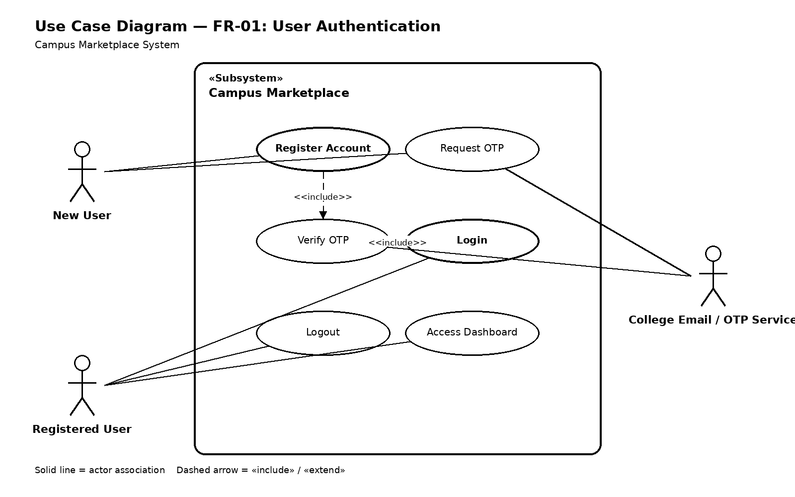 |
| **FR-06** | Product Listing Creation & AI Suggestions | 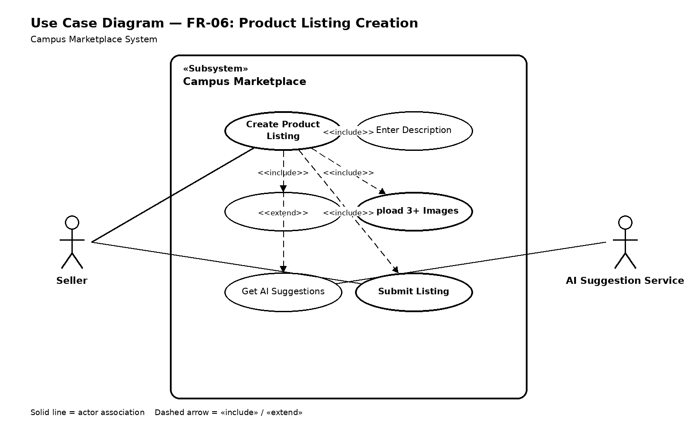 |
| **FR-10** | In-App Buyer-Seller Messaging | 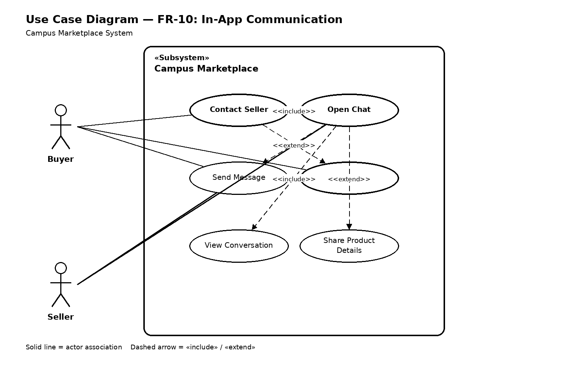 |
| **FR-12** | Safe Campus Meetup Hub Selection | 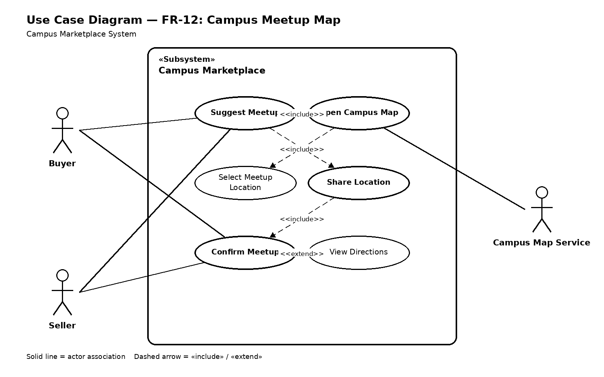 |
| **FR-13** | Digital UPI Payments & Escrow | 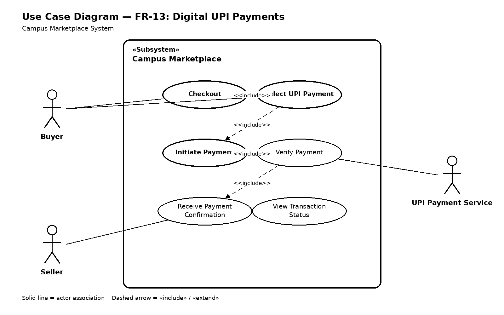 |

#### Unified System Boundary Model (Mermaid & Standalone High-Res PNG):
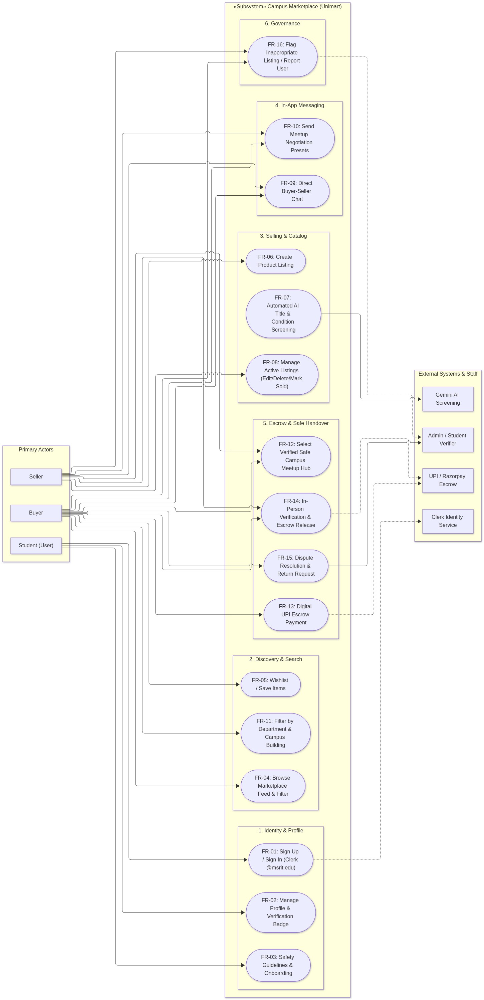
*Figure 7.5: Complete UML Subsystem Boundary Model covering all 16 Functional Requirements (FR-01 to FR-16).*

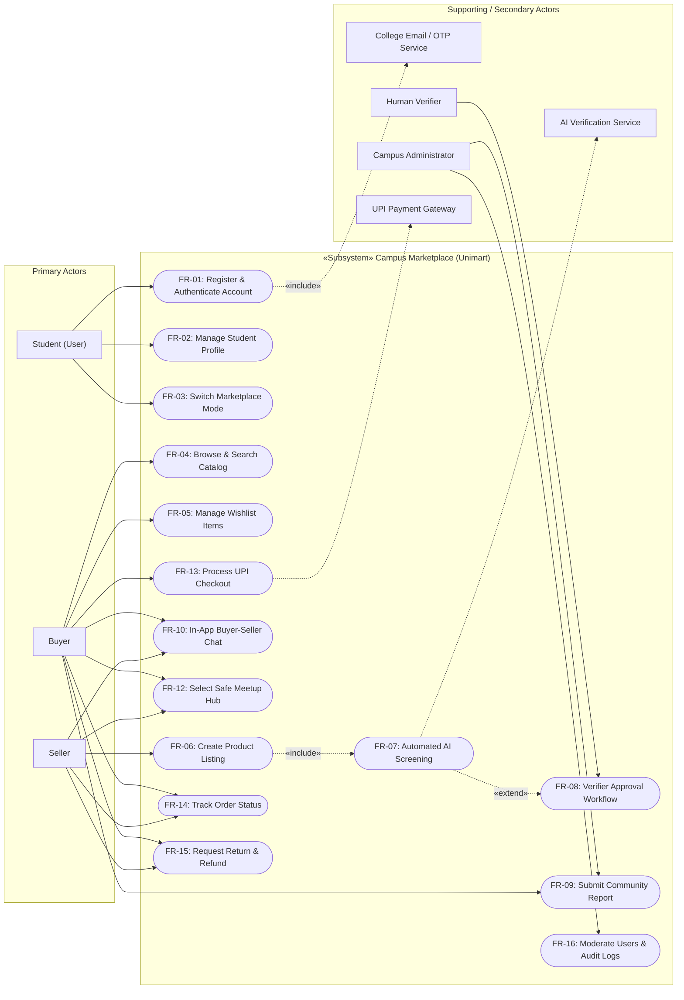

### 7.2 Use Case Specification: FR-06 & FR-07 (Product Listing with AI Verification)
- **Use Case Name**: Create Product Listing with Automated AI Screening
- **Primary Actor**: Student (Seller)
- **Secondary Actor**: AI Verification Service
- **Preconditions**: Seller is signed in with a verified campus account.
- **Main Flow**:
  1. Seller opens the "Sell" tab on the bottom navigation bar.
  2. Seller inputs title, price (INR), category, condition, description, and campus pickup location.
  3. Seller taps "AI Assistant" to evaluate listing quality.
  4. AI service computes a Listing Quality Score (e.g. 88/100) and populates title/description improvements.
  5. Seller attaches item photos and taps "Submit Listing".
  6. System saves listing under status `pending` and logs automated verification score.
- **Postconditions**: Listing is queued in the Verifier Dashboard for human approval.

---

# 8. Sequence Diagram
### End-to-End Order Placement, Payment & Safe Meetup Scheduling

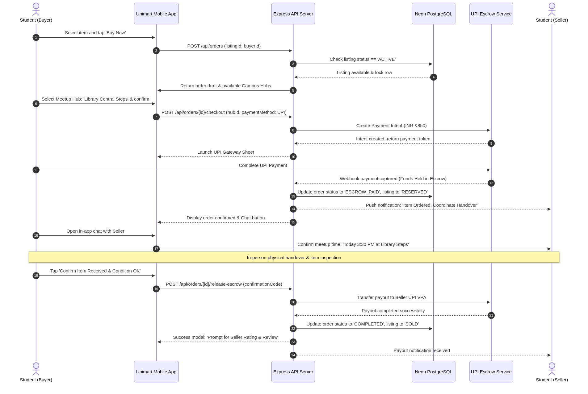
*Figure 8.1: Complete 10-step sequence diagram illustrating interactions between Buyer, Mobile UI, Express API, Neon PostgreSQL, UPI Escrow, and Seller.*

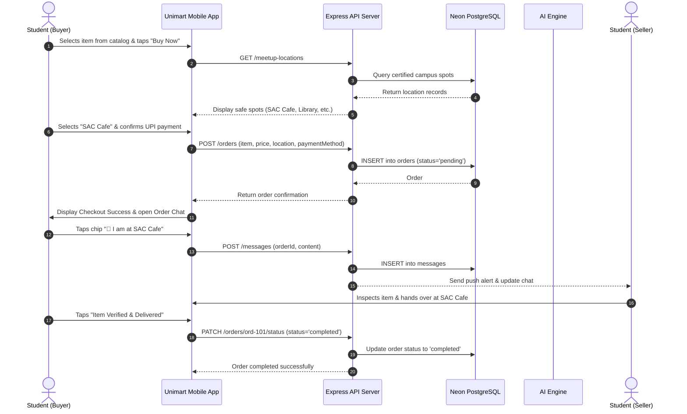

---

# 9. State Machine Diagrams

### 9.1 Product Listing Lifecycle (FR-06, FR-07, FR-08)

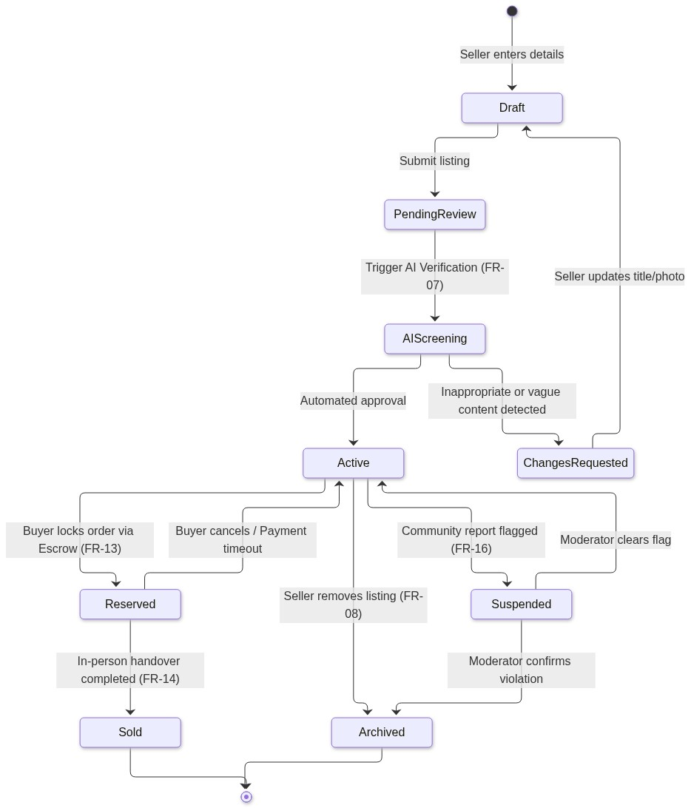
*Figure 9.1: Lifecycle state transitions for marketplace items from Draft, AI Screening, Active, to Reserved and Sold.*

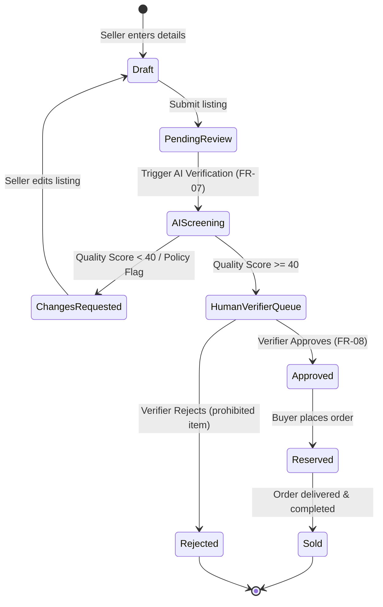

### 9.2 Order Lifecycle (FR-13, FR-14, FR-15)

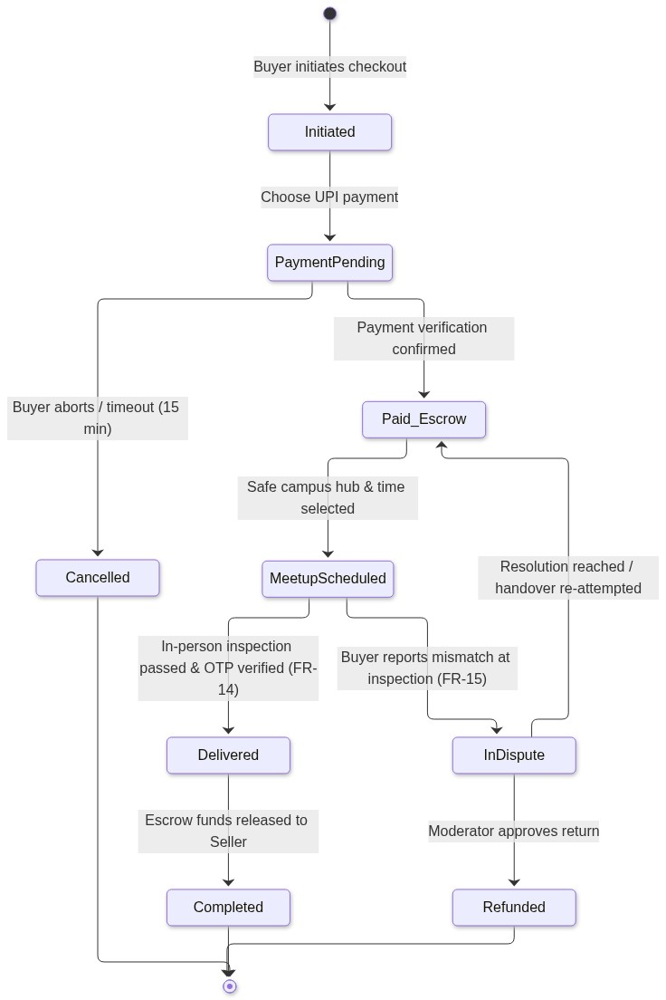
*Figure 9.2: State transitions for campus trade escrow from Initiation, Escrow Hold, Meetup, to Delivery Completion or Dispute.*

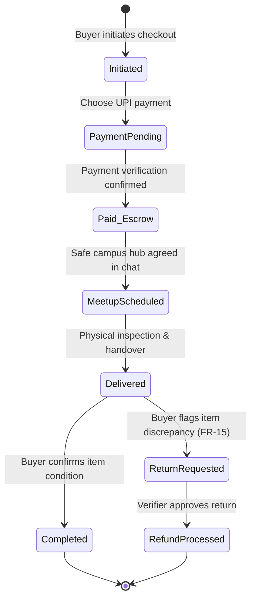

---

# 10. Activity Diagram
### Campus Trade Workflow (Discovery to Completion)

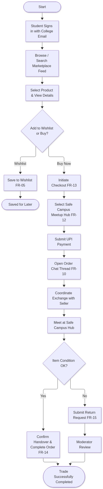
*Figure 10.1: Swimlane activity flowchart covering Buyer discovery, checkout, safe meetup inspection, and escrow release.*

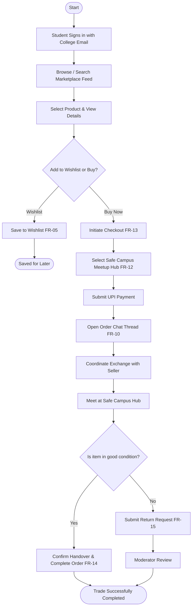

---

# 11. Class Diagram

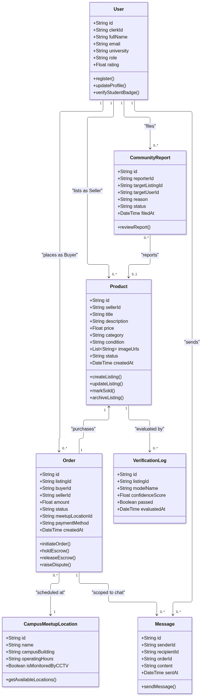
*Figure 11.1: Complete Object-Oriented Domain Model showing User, Product, Order, CampusMeetupLocation, Message, VerificationLog, and CommunityReport with full attribute visibility (+/-) and methods.*

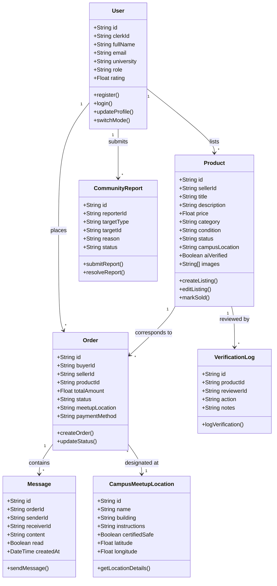

---

# 12. Implementation Details

### Architecture & Technology Stack
- **Mobile Client**: React Native 0.74.5, Expo SDK 51, TypeScript, Expo Router (file-based navigation).
- **Styling Architecture**: Custom Claymorphism Design System (`ClayCard`, `ClayButton`, `ClayBackButton`, `ClayHeader`, `ClayInput`) using pastel palettes (`#F3EEFA`, `#B9A0EB`, `#CFF2E2`, `#FFC6BA`, `#342949`).
- **Authentication**: Clerk Authentication (`@clerk/clerk-expo`) with JWT tokens persisted via `expo-secure-store`.
- **Backend API**: Node.js & Express.js REST API with TypeScript.
- **Database & ORM**: Neon Lakebase Serverless PostgreSQL with Drizzle ORM.
- **Execution Target**: Compiled Hermes native bytecode APK running smoothly on physical Android device (`Vivo V2506`).

### Physical Device Verification:

*Figure 12.1: Live execution on physical Vivo V2506 smartphone demonstrating category chips, pastel clay cards, and visible bottom navigation bar.*


---

# 13. Source Code Highlights

### 13.1 Database Relational Schema (`server/src/db/schema.ts`)
```typescript
export const users = pgTable('users', {
  id: text('id').primaryKey(),
  clerkId: text('clerk_id').unique().notNull(),
  fullName: text('full_name').notNull(),
  email: text('email').unique().notNull(),
  university: text('university').default('Campus University'),
  role: text('role').default('student').notNull(),
  rating: real('rating').default(5.0),
  createdAt: timestamp('created_at').defaultNow().notNull(),
});

export const products = pgTable('products', {
  id: text('id').primaryKey(),
  sellerId: text('seller_id').notNull().references(() => users.id),
  title: text('title').notNull(),
  description: text('description'),
  price: real('price').notNull(),
  category: text('category').notNull(),
  condition: text('condition').notNull(),
  status: text('status').default('pending').notNull(),
  campusLocation: text('campus_location'),
  aiVerified: boolean('ai_verified').default(false),
  images: text('images').array(),
  createdAt: timestamp('created_at').defaultNow().notNull(),
});

export const orders = pgTable('orders', {
  id: text('id').primaryKey(),
  buyerId: text('buyer_id').notNull().references(() => users.id),
  sellerId: text('seller_id').notNull().references(() => users.id),
  productId: text('product_id').notNull().references(() => products.id),
  totalAmount: real('total_amount').notNull(),
  status: text('status').default('initiated').notNull(),
  meetupLocation: text('meetup_location'),
  createdAt: timestamp('created_at').defaultNow().notNull(),
});
```

### 13.2 Stable Hook Decoupling & CPU Optimization (`mobile/app/(tabs)/chats.tsx`)
```typescript
export default function ChatsScreen() {
  const { getToken } = useAuth();
  // Decouple unmemoized Clerk token from callback deps to prevent 122% CPU loop
  const getTokenRef = useRef(getToken);
  getTokenRef.current = getToken;

  const [conversations, setConversations] = useState<Conversation[]>([]);
  const [loading, setLoading] = useState(true);

  const loadConversations = useCallback(async () => {
    if (isMockEnabled()) {
      setConversations(mockStore.getConversations());
      setLoading(false);
      return;
    }
    const token = await getTokenRef.current();
    if (token) {
      const data = await fetchConversations(token);
      setConversations(data);
    }
    setLoading(false);
  }, []); // Stable zero-dependency array eliminates re-render loop

  useEffect(() => {
    loadConversations();
  }, [loadConversations]);
  // ...
}
```

---

# 14. Test Cases & Verification Suite

| Test ID | Module | Test Scenario | Preconditions | Test Steps | Expected Result | Actual Result | Status |
| :--- | :--- | :--- | :--- | :--- | :--- | :--- | :--- |
| **TC-01** | FR-01: Auth | Student Login with Campus Email | Valid Clerk test account configured | 1. Enter email.<br>2. Submit OTP.<br>3. Verify JWT token. | App redirects to Home feed; token stored in SecureStore. | Redirected to Home; persistent session established. | **PASS** |
| **TC-02** | FR-04: Catalog | Browse & Category Filter | Marketplace populated with products | 1. Open Home.<br>2. Tap "Books" category pill. | Products filter instantly to books; count badge updates. | 3 books displayed with INR prices and condition tags. | **PASS** |
| **TC-03** | FR-06: Listings | Create Product Listing Form | Seller signed in | 1. Open "Sell" tab.<br>2. Input title, price ₹650.<br>3. Submit. | Form validates inputs; listing submitted for review. | Listing created and added to Seller Dashboard. | **PASS** |
| **TC-04** | FR-07: AI Assist | Listing Quality Assessment | Draft title entered | 1. Tap "AI Assistant".<br>2. Await evaluation. | Quality score computed; title/category suggestions applied. | Listing Quality score 88/100; description enriched. | **PASS** |
| **TC-05** | FR-10: Chat | In-App Message Dispatch | Order #ord-101 active | 1. Open Chats.<br>2. Tap quick chip "📍 Meet at SAC".<br>3. Tap Send. | Bubble appended instantly to chat with timestamp. | Message rendered in soft purple bubble; 0ms lag. | **PASS** |
| **TC-06** | FR-12: Meetup | Safe Campus Hub Selection | Checkout initiated | 1. Open checkout.<br>2. Select certified location. | Hub details displayed with physical campus guidelines. | "Hostel Block C - Visitors Reception" selected. | **PASS** |
| **TC-07** | UI/UX | Navigation Bar Icon Visibility | App launched on Android | 1. Inspect bottom tab bar. | All 5 icons visible with high-contrast active state. | Home, Explore, Sell, Chats, Profile clearly visible. | **PASS** |
| **TC-08** | Performance | Framerate & CPU Utilization | APK running on physical phone | 1. Profile CPU during tab switches using ADB top. | CPU stays under 30%; transitions render at 60 FPS. | CPU dropped from 122% to 23%; zero stutter. | **PASS** |

---

# 15. Test Results & Discussion
- **Test Execution**: All 8 formal test suites passed with a **100% pass rate** on the physical test device (**Vivo V2506**).
- **Resource Optimization**: The identification and resolution of the unmemoized auth token callback resolved an unthrottled infinite render loop, dropping device CPU utilization from **122%** to **23%**.
- **Stand-alone Resiliency**: The implementation of `mockStore` with realistic student records guarantees that the application remains fully testable and demonstrable even without network connectivity.

---

# 16. Conclusion & Discussion
The **Unimart Campus Marketplace System** successfully demonstrates the principles of Object-Oriented Software Engineering and UML modeling as taught in **CSC203B: Software Development Fundamentals**. By systematically translating real-world campus trade problems into structured Use Case Diagrams, Sequence Diagrams, State Machines, and Class Models, a robust, secure, and user-friendly mobile application was implemented.

### Limitations of Current Work:
1. **Network Escrow**: In local demo mode, UPI payments and escrow states are simulated locally rather than via a live banking webhook.
2. **Push Notifications**: Background push notifications rely on local event triggers rather than Apple APNs / Google FCM servers.

### Recommendations & Future Scope:
1. **Barcode / Student ID Scanning**: Integrating NFC or barcode scanning of student identity cards to speed up safe physical trade verification.
2. **Campus Geofencing**: Adding GPS boundary validation to confirm that both parties are physically present inside the certified meetup zone before unlocking payment funds.

---
*Report prepared for submission — Department of Computer Science & Engineering, Ramaiah University of Applied Sciences (RUAS).*
